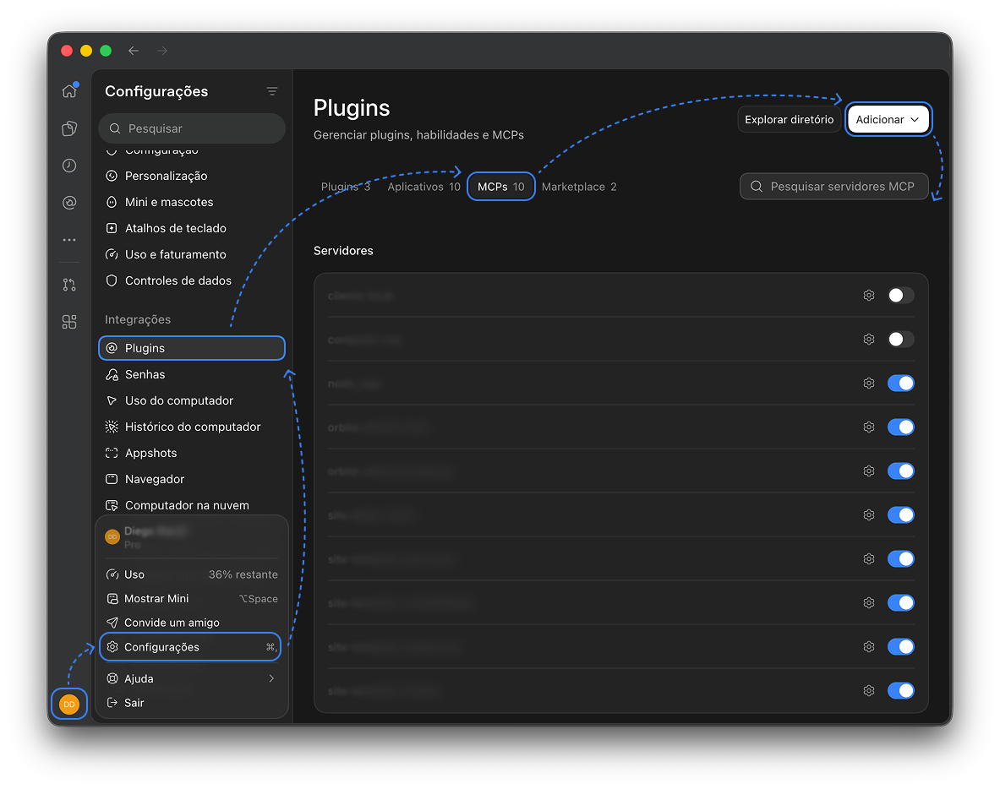
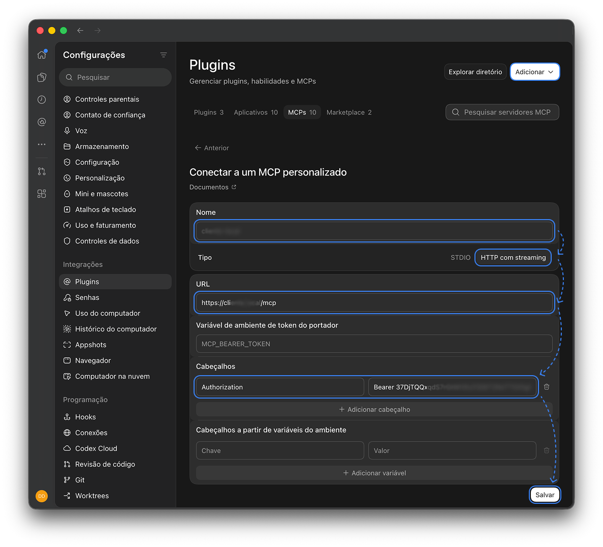
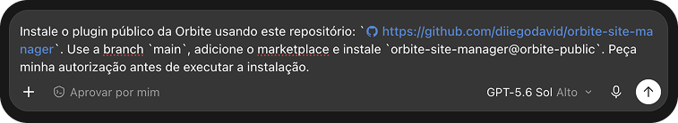

# Orbite Site Manager

Use este tutorial para conectar seu Site ao Codex e instalar o plugin público da Orbite. Você fará tudo em passos pequenos.

## Antes de começar

Deixe abertas estas duas telas:

- o seu site já logado;
- o Codex, já conectado à sua conta.

> **Cuide da sua chave:** a chave MCP dá acesso ao seu Site. Cole-a somente na configuração do MCP. Não envie a chave em conversas, imagens, arquivos ou pedidos de ajuda.

## 1. Pegue a URL e a chave MCP

1. No seu site, abra **Configurações do Agente de IA**.
2. Ative o MCP e salve a configuração, se ele ainda estiver desligado.
3. Copie a **URL MCP** mostrada no painel.
4. Copie também a **chave MCP** e guarde-a em um lugar seguro por alguns minutos.

## 2. Conecte o Site ao Codex

1. No Codex, abra seu **perfil**.
2. Entre em **Configurações > Plugins > MCPs**.
3. Clique em **Adicionar > Adicionar servidor MCP**.



4. No campo de nome, escreva algo fácil de reconhecer, como `Meu Site`.
5. Escolha **HTTP com streaming**.
6. Cole a **URL MCP** que você copiou do WordPress.
7. Em **Cabeçalhos**, preencha:
   - nome: `Authorization`;
   - valor: `Bearer SUA_CHAVE_MCP`.

8. Confira se existe um espaço entre `Bearer` e a chave. Depois, salve.



O exemplo `SUA_CHAVE_MCP` é apenas um marcador. Use a sua chave somente no campo protegido da configuração.

## 3. Teste a conexão

Abra uma conversa no Codex e envie este pedido, trocando o nome pelo que você escolheu:

> Use a conexão MCP **Orbite - Meu Site** para verificar a conexão e listar as páginas do meu Site. Não altere nada.

Se o Codex mostrar as páginas, a conexão está pronta.

## 4. Peça ao Codex para instalar o plugin

Esta é a forma mais simples de instalar:

1. Copie a URL deste repositório público.
2. Abra uma conversa no Codex.
3. Envie o pedido abaixo e troque o marcador pela URL copiada:

> Instale o plugin público da Orbite usando este repositório: `https://github.com/diiegodavid/orbite-site-manager`. Use a branch `main`, adicione o marketplace e instale `orbite-site-manager@orbite-public`. Peça minha autorização antes de executar a instalação.



4. Confira o pedido de autorização mostrado pelo Codex e aceite para continuar.
5. Quando a instalação terminar, abra uma nova conversa. Assim, o Codex carrega as skills da Orbite.

## 5. Faça o teste final

Na nova conversa, envie:

> Use as skills da Orbite e a conexão MCP **Orbite - Meu Site** para listar as páginas do meu Site. Não altere nada.

Pronto! Agora você pode pedir ajuda para cuidar do conteúdo e da aparência do Site.

## O que o plugin permite

- criar e editar páginas usando modelos já cadastrados;
- publicar páginas ou devolvê-las para rascunho, sempre com sua autorização;
- gerenciar artigos, categorias e SEO;
- ajustar configurações globais, menus, cabeçalhos e rodapés;
- criar componentes interativos nos espaços de mídia.
- escolher mídias diferentes para desktop e mobile, inclusive em mídia principal, listas, galerias e backgrounds.

A criação de arquivos do tema, como PHP, SCSS e JavaScript, continua reservada à equipe Orbite.

## Segurança

- use somente a URL e a chave mostradas no painel do seu próprio Site;
- confira o que o Codex pretende fazer antes de autorizar uma mudança;
- nunca publique nem compartilhe sua chave MCP;
- para testar, peça primeiro ações que apenas consultem informações, como listar páginas.

## Alternativa: instalar pelo terminal

Se você já se sente confortável usando o terminal, troque o marcador pela URL deste repositório e execute:

```bash
codex plugin marketplace add https://github.com/diiegodavid/orbite-site-manager --ref main
codex plugin add orbite-site-manager@orbite-public
```

Depois, abra uma nova conversa no Codex para carregar as skills instaladas.

## Atualizações opcionais

Você pode atualizar manualmente quando quiser:

```bash
codex plugin marketplace upgrade orbite-public
```

O plugin também pode oferecer uma verificação automática a cada 15 dias. Ela só é criada com a sua autorização, roda no seu computador e depende do computador ligado e do Codex aberto no horário marcado.

Se essa configuração não aparecer após a instalação, abra uma nova conversa e peça: **“Use a skill `orbite-plugin-updater` para configurar as atualizações deste plugin.”** O Codex explicará a opção e pedirá sua autorização antes de criar o agendamento.

